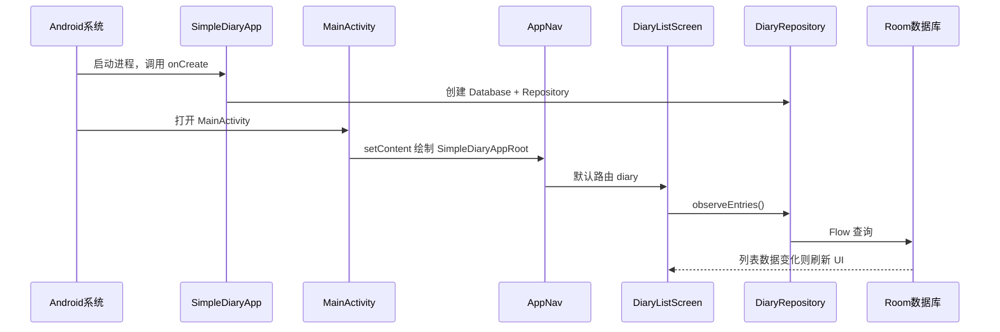

# 日迹 SimpleDiary — 新手入门与架构说明

面向**没有 Android 开发经验**的读者：先建立整体图景，再按目录对照代码。

---

## 1. 先建立这些概念（5 分钟）

### 1.1 一个 Android App 在干什么？

可以把 App 想成三层：

```text
界面（用户看见、点得到）
    ↕
业务逻辑（决定“点了之后发生什么”）
    ↕
数据（存在手机本地的数据库 / 文件）
```

本项目对应关系：

| 层 | 本项目用什么 | 目录 |
|----|--------------|------|
| 界面 | Jetpack **Compose**（用 Kotlin 代码画 UI） | `ui/` |
| 业务逻辑 | **ViewModel** + **Repository** | `ui/*/…ViewModel.kt`、`data/DiaryRepository.kt` |
| 数据 | **Room**（SQLite 封装）+ 本地媒体文件 | `data/`、`files/media/` |

### 1.2 你需要认识的几个“零件”

| 名词 | 一句话 |
|------|--------|
| **Activity** | App 的一个“窗口容器”。本项目只有 `MainActivity`，几乎所有界面都画在它里面。 |
| **Compose** | 现代 Android UI 写法：函数叫 `@Composable`，描述“现在界面长什么样”。 |
| **Navigation** | 页面跳转路由器（日记列表 → 编辑页 → 返回）。 |
| **ViewModel** | 扛住界面逻辑和状态；旋转屏幕时尽量不丢数据。 |
| **Flow / StateFlow** | 数据变化流：数据库一变，界面自动刷新。 |
| **Room** | 用注解写数据库表和查询，底层是 SQLite。 |
| **Repository** | 对外提供“业务接口”，内部再调数据库/文件，界面不直接碰数据库。 |
| **协程 `suspend` / `viewModelScope.launch`** | 异步干活（读写库、复制文件），不卡界面。 |
| **Gradle** | 构建工具：下载依赖、编译、打包 APK。配置在 `*.gradle.kts`。 |

### 1.3 本项目刻意不做的事

- 无账号、无后端、无网络同步
- 无内购（后续可加）
- 第一版不做应用锁

这能让你先把「界面 ↔ 本地存储」主链路学透。

---

## 2. 用户能看到的功能地图

```text
底部两个 Tab
├── 日记
│   ├── 列表：只显示「年月日」+ 左侧心情色条（不显示正文）
│   ├── 右下角 + ：新建并进入编辑
│   └── 条目右侧调色板：快速改心情色
│
├── 回顾
│   ├── 默认「那年今日」
│   ├── 右下角切换：那年今日 → 那月今日 → 那周今日
│   └── 点击条目同样进入编辑页
│
└── 编辑页（全屏，无底栏）
    ├── 直接输入正文
    ├── 底部：加图片 / 拍照 / 视频 / 音频
    ├── 右下角：心情颜色
    └── 返回：有内容则保存；正文和媒体都空则丢弃
```

### 回顾三种模式含义

| 模式 | 筛什么 |
|------|--------|
| 那年今日 | 往年同一天（同月同日），不含今天 |
| 那月今日 | 任意年月的同一日号（如每月 17 日），不含今天 |
| 那周今日 | 同一星期几（如每个周一），不含今天 |

---

## 3. 目录结构（按“去哪改什么”记）

```text
SimpleDiary/
├── settings.gradle.kts          # 工程名、包含哪些模块
├── build.gradle.kts             # 插件版本（AGP、Kotlin、KSP）
├── gradle.properties            # Gradle 全局开关
├── app/build.gradle.kts         # App 依赖、minSdk、包名等 ★常看
├── app/src/main/
│   ├── AndroidManifest.xml      # 声明 Activity、权限、FileProvider
│   ├── java/com/simplediary/app/
│   │   ├── MainActivity.kt      # 入口：套上主题 + 导航根
│   │   ├── SimpleDiaryApp.kt    # Application：创建 Repository 单例
│   │   ├── data/                # 数据层 ★核心
│   │   ├── ui/                  # 界面层
│   │   │   ├── navigation/      # 底栏 + 路由
│   │   │   ├── diary/           # 日记列表 / 编辑
│   │   │   ├── onthisday/       # 回顾 Tab
│   │   │   ├── components/      # 可复用小组件
│   │   │   └── theme/           # 淡蓝白配色与字体
│   │   └── util/                # 日期工具
│   └── res/                     # 字符串、主题、图标、FileProvider 路径
└── docs/                        # 文档（本文件）
```

**记忆口诀：**  
改长什么样 → `ui/`；改存什么/怎么存 → `data/`；改跳转 → `navigation/`；改颜色 → `theme/`。

---

## 4. 启动链路（App 打开后发生了什么）



对应代码：

1. [`SimpleDiaryApp.kt`](../app/src/main/java/com/simplediary/app/SimpleDiaryApp.kt)  
   - 在 `onCreate` 里创建 `DiaryDatabase` 和 `DiaryRepository`  
   - 整个 App 共用一个 `repository`

2. [`MainActivity.kt`](../app/src/main/java/com/simplediary/app/MainActivity.kt)  
   - `setContent { SimpleDiaryTheme { SimpleDiaryAppRoot(app) } }`  
   - 几乎没有业务逻辑

3. [`AppNav.kt`](../app/src/main/java/com/simplediary/app/ui/navigation/AppNav.kt)  
   - 底栏两个目的地：`diary` / `on_this_day`  
   - 编辑页：`editor/{entryId}`  
   - 编辑页时隐藏底栏

---

## 5. 数据层详解（最值得先读透）

### 5.1 两张表

**日记表 `diary_entries`** — [`DiaryEntry.kt`](../app/src/main/java/com/simplediary/app/data/DiaryEntry.kt)

| 字段 | 作用 |
|------|------|
| `id` | 主键，自增 |
| `body` | 正文 |
| `moodColor` | 心情色（ARGB Long，如 `0xFF5BA4D9`） |
| `createdAt` / `updatedAt` | 时间戳毫秒 |
| `entryDateEpochDay` | 本地日历“第几天”，方便按年月日筛选回顾 |

**媒体表 `diary_media`** — [`DiaryMedia.kt`](../app/src/main/java/com/simplediary/app/data/DiaryMedia.kt)

| 字段 | 作用 |
|------|------|
| `entryId` | 外键，指向日记；日记删除时级联删媒体行 |
| `type` | `IMAGE` / `VIDEO` / `AUDIO` |
| `filePath` | 应用私有目录里的真实文件路径 |
| `sortOrder` | 排序 |

> 注意：Room 只存**路径和元数据**；图片/视频/音频二进制在 `context.filesDir/media/`，由 [`MediaFileStore.kt`](../app/src/main/java/com/simplediary/app/data/MediaFileStore.kt) 管理。

### 5.2 DAO / Database / Repository 分工

```text
UI / ViewModel
      ↓ 只调用
DiaryRepository          ← 业务规则（空内容丢弃、回顾过滤、复制文件）
      ↓
DiaryDao                 ← SQL 查询接口（Room 生成实现）
      ↓
SQLite 文件 simple_diary.db
```

| 文件 | 职责 |
|------|------|
| `DiaryDao.kt` | `observeAll`、`insert`、`update`、查空草稿等 |
| `DiaryDatabase.kt` | 建库、提供 `diaryDao()` |
| `Converters.kt` | `MediaType` ↔ 字符串，供 Room 存枚举 |
| `DiaryRepository.kt` | **所有业务入口**，界面不要绕过它直接写 DAO |

### 5.3 关键业务规则：空内容不保存

新建日记时流程：

1. 点 `+` → `createDraft()` **先插入一条空日记**，拿到 `id`，再跳编辑页  
2. 用户返回 → `finalizeEditor(id, body, moodColor)`  
   - 正文（trim 后）非空 **或** 已有媒体 → `update` 保存  
   - 否则 → `deleteEntry`，列表不会出现这条  
3. 列表打开时还会 `cleanupEmptyDrafts()`，清掉异常退出残留的空草稿

这是本产品最核心的一条规则，改保存逻辑时优先看 Repository。

### 5.4 回顾筛选逻辑在哪？

不在 SQL 里写三种复杂条件，而在 Repository：

- 先 `observeAllExceptToday` 拿到“不是今天”的日记  
- 再用 `matchesOnThisDay(entry, today, mode)` 内存过滤  

文件：`DiaryRepository.kt` 底部私有函数。以后要改“那月今日”定义，改这里即可。

---

## 6. 界面层怎么组织

### 6.1 推荐阅读顺序（由外到内）

1. `AppNav.kt` — 有哪些页面、怎么跳  
2. `DiaryListScreen.kt` + `DiaryListViewModel.kt`  
3. `DiaryEditorScreen.kt` + `DiaryEditorViewModel.kt`  
4. `OnThisDayScreen.kt` + `OnThisDayViewModel.kt`  
5. `components/` — 列表行、色板、媒体条  

### 6.2 Screen 和 ViewModel 的边界

| | Screen（Composable） | ViewModel |
|--|----------------------|-----------|
| 该做 | 画 UI、收点击、调系统相册/相机 | 持有状态、调 Repository、发协程 |
| 不该做 | 直接写数据库、复制文件 | 不知道具体 Button 长什么样 |

例如新建日记：

```text
DiaryListScreen 点击 FAB
  → viewModel.createDraft()        // ViewModel / Repository 插库
  → onOpenEditor(id)               // Navigation 跳转
  → DiaryEditorScreen(entryId)
```

### 6.3 编辑页媒体是怎么加进去的？

[`DiaryEditorScreen.kt`](../app/src/main/java/com/simplediary/app/ui/diary/DiaryEditorScreen.kt) 使用 Android 的 **Activity Result API**：

- `GetContent()`：从系统文件选择器选图/视频/音频  
- `TakePicture()`：拍照写入 `FileProvider` 提供的临时文件  

选完得到 `Uri` → `viewModel.addMedia(uri, type)` → Repository 复制到私有目录 → 插入 `diary_media` → Flow 推给 UI → [`MediaAttachments.kt`](../app/src/main/java/com/simplediary/app/ui/components/MediaAttachments.kt) 显示；点开用 ExoPlayer 播放。

`FileProvider` 在 `AndroidManifest.xml` + `res/xml/file_paths.xml` 配置，作用是：**安全地把应用私有文件路径临时共享给相机 App**。

### 6.4 主题

- `ui/theme/Color.kt`：淡蓝 / 白等色值  
- `Theme.kt`：组装 Material3 `ColorScheme`  
- `Type.kt`：标题、正文文字样式  

改主色调，优先改 `Color.kt` 和 `MoodColors.kt`。

---

## 7. 一条完整用户路径（对着代码走一遍）

### 场景：写一篇带照片的日记

```text
1. 打开 App
   MainActivity → AppNav → DiaryListScreen

2. 点右下角 +
   DiaryListViewModel.createDraft()
   → Repository.createDraft() 插入空行，返回 id
   → navigate("editor/id")

3. 编辑页加载
   DiaryEditorViewModel.init 读出 entry，body 放进 StateFlow
   LaunchedEffect 请求焦点，键盘弹出

4. 输入文字
   TextField onValueChange → viewModel.onBodyChange
   （此时只改内存状态，尚未写库）

5. 选一张图
   GetContent → addMediaFromUri
   → MediaFileStore 复制到 files/media/xxx.jpg
   → insert diary_media
   → MediaAttachmentRow 出现缩略图

6. 点返回
   BackHandler / 顶栏返回 → finalizeAndExit()
   → 有正文或媒体 → update 日记
   → popBackStack 回到列表
   → observeEntries Flow 自动刷新，出现新的一行（只有日期+色条）
```

### 场景：打开编辑又什么都不写就返回

```text
finalizeEditor 发现空 → deleteEntry → 列表无新记录
```

---

## 8. 关键配置文件（上架/换机前会碰到）

### `app/build.gradle.kts`

| 项 | 当前值 | 含义 |
|----|--------|------|
| `namespace` / `applicationId` | `com.simplediary.app` | 应用唯一 ID |
| `minSdk` | 26 | 最低支持 Android 8.0 |
| `compileSdk` / `targetSdk` | 35 | 编译/目标 API |
| Compose / Room / Coil / Media3 | dependencies 块 | UI、数据库、图片、播放器 |

### `AndroidManifest.xml`

- 注册 `SimpleDiaryApp`、`MainActivity`  
- 相机权限（可选硬件）  
- `FileProvider` 给拍照用  

### 资源 `res/`

- `strings.xml`：应用名「日迹」  
- `drawable/ic_launcher.xml`：简易矢量图标  
- `xml/file_paths.xml`：允许分享 `media/` 目录  

---

## 9. 你在 Android Studio 里建议怎么学

按这个顺序动手，比只看书快：

1. **能跑起来**：Open `SimpleDiary` → Sync → 真机 Run  
2. **改一处看得见的**：改 `strings.xml` 里的应用名，重装后看桌面图标下文字  
3. **改颜色**：改 `Color.kt` 的 `SoftBlue`，看主色变化  
4. **改文案**：改编辑页 placeholder「写下此刻…」  
5. **跟一次保存**：在 `finalizeEditor` 打断点，空返回 / 有字返回各走一遍  
6. **跟一次回顾**：手动改几条日记的日期（或连写几天）测三种模式  

---

## 10. 常见困惑 FAQ

**Q: 为什么点 + 会先插入数据库？**  
A: 编辑页需要稳定的 `entryId` 才能挂媒体外键。空内容会在返回时删掉，列表平时看不到垃圾数据。

**Q: 列表为什么不显示正文？**  
A: 产品设定极简：列表只做日期索引；正文只在编辑页看。

**Q: Flow 是什么？**  
A: 可观察的数据流。Room 的 `observeAll()` 返回 `Flow`，数据库一变就推送新列表，Compose 用 `collectAsStateWithLifecycle()` 转成界面状态。

**Q: 为什么有 Screen 又有 ViewModel？**  
A: 分开后：换 UI 不影响存数据；测业务逻辑也不必启动完整界面。

**Q: 和鸿蒙 / iOS 的关系？**  
A: 当前是纯 Android。以后迁移时，**产品规则和数据模型**可复用，UI 代码（Compose）通常要重写。

**Q: 我想加“删除日记”从哪改？**  
A: UI 在列表加入口 → ViewModel 调 `repository.deleteEntry(id)`（已实现删库+删文件）。

**Q: 我想加搜索？**  
A: DAO 加 `LIKE` 查询 → Repository 暴露 → 列表 Screen 加搜索框。仍保持 ViewModel 中转。

---

## 11. 文件速查表

| 我想改… | 打开这个文件 |
|---------|----------------|
| 启动后第一眼页面 | `ui/navigation/AppNav.kt` |
| 日记列表长什么样 | `ui/diary/DiaryListScreen.kt` |
| 列表一行样式 | `ui/components/DiaryListItem.kt` |
| 编辑页交互 | `ui/diary/DiaryEditorScreen.kt` |
| 保存/丢弃规则 | `data/DiaryRepository.kt` → `finalizeEditor` |
| 表结构 | `data/DiaryEntry.kt`、`DiaryMedia.kt` |
| SQL | `data/DiaryDao.kt` |
| 回顾筛选 | `data/DiaryRepository.kt` → `matchesOnThisDay` |
| 心情色板 | `data/MoodColors.kt` |
| 主题色 | `ui/theme/Color.kt` |
| 依赖版本 | `app/build.gradle.kts` |

---

## 12. 架构总图（放在心里的那一张）

```text
┌─────────────────────────────────────────────┐
│                 MainActivity                 │
│  SimpleDiaryTheme + SimpleDiaryAppRoot       │
└──────────────────────┬──────────────────────┘
                       │
          ┌────────────┴────────────┐
          │         AppNav          │
          │  diary / on_this_day    │
          │  editor/{id}            │
          └────────────┬────────────┘
                       │
     ┌─────────────────┼─────────────────┐
     ▼                 ▼                 ▼
 DiaryListScreen  OnThisDayScreen  DiaryEditorScreen
 DiaryListVM      OnThisDayVM      DiaryEditorVM
     │                 │                 │
     └────────────┬────┴─────────────────┘
                  ▼
           DiaryRepository
          ┌───────┴────────┐
          ▼                ▼
       DiaryDao      MediaFileStore
          ▼                ▼
     Room/SQLite     files/media/*
```

把这张图记住，再下钻任一文件，就不会迷路。

---

下一步建议：用 Android Studio 跑起来后，带着第 7 节「写一篇带照片的日记」在代码里下断点走一遍；走通这一条，整个框架就算真正入门了。
